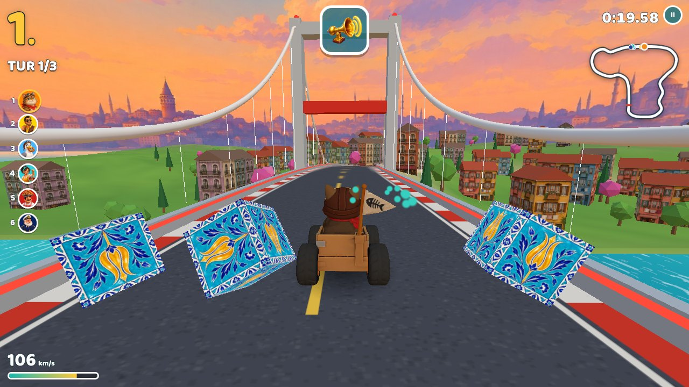
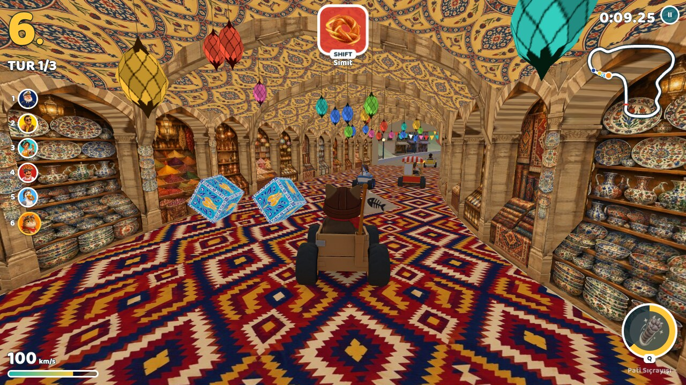
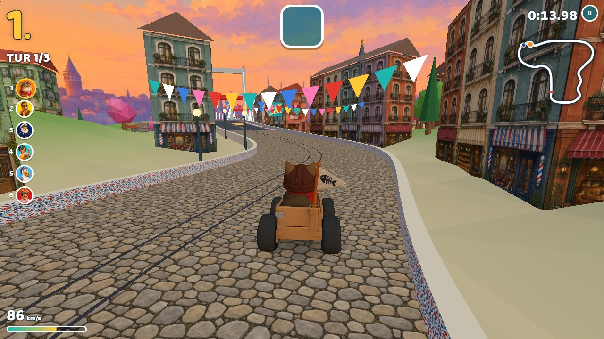

# Boğaz Turu

İstanbul'da geçen, three.js ile yazılmış bir kart yarışı. Eminönü sahilinden kalk, Kapalıçarşı'nın içinden geç, Galata yokuşunda nostaljik tramvayı solla, Boğaz Köprüsü'nden Anadolu'ya geç, sahil yolundan inip balıkçıların arasından Galata Köprüsü'yle geri dön. Üç tur, altı yarışçı.

**Oyna: https://bogaz-turu.vercel.app**



| Kapalıçarşı | Galata yokuşu |
| --- | --- |
|  |  |

## Oynanış

| Tuş | İşlev |
| --- | --- |
| `←` `→` / `A` `D` | Yön |
| `↑` / `W` | Gaz |
| `↓` / `S` | Fren, geri |
| `BOŞLUK` | Zıpla ve drift. Basılı tutup dönersen kıvılcımlar renk değiştirir; bırakınca mini turbo |
| `SHIFT` / `E` / `X` | Eşyayı kullan |
| `Q` / `F` / `C` | Özel gücü kullan (gösterge dolunca) |
| `H` | Tuş rehberini aç/kapat |
| `ESC` / `P` | Duraklat |
| `M` | Sesi kapat |

Oyun kolu (A gaz, B fren, RB drift, X eşya, Y özel güç) ve dokunmatik ekran da desteklenir (dokunmatikte gaz kendiliğinden basılıdır). Tuşlar yarışın başında ekranın altında kısaca gösterilir; eşya yuvasının ve güç göstergesinin üstünde de hangi tuşa basılacağı yazar. Geri sayımda "Bir!" denirken gaza basarsan roket kalkış yaparsın.

### Yarışçılar

Her yarışçının kendi motor sesi, ağırlığı ve zamanla dolan bir özel gücü var. Güç yaklaşık 20 saniyede dolar; geride olan daha çabuk doldurur, iyi drift ve çini sandıklar da doldurur.

| | Hız | İvme | Yol tutuş | Ağırlık | Özel güç |
| --- | --- | --- | --- | --- | --- |
| Simitçi Cemal | ●●●○○ | ●●●○○ | ●●●●○ | ●●●○○ | **Simit Yağmuru** — öndeki üç rakibe birer güdümlü simit |
| Kaptan Nuri | ●●●●● | ●●○○○ | ●●○○○ | ●●●●● | **Tam Yol İleri** — zırhlı hücum: darbe almaz, değdiğini savurur |
| Tekir | ●●○○○ | ●●●●● | ●●●●○ | ●○○○○ | **Pati Sıçrayışı** — herkesin üstünden atlar, inişte çevresini iter, turbo alır |
| Martı Rıfkı | ●●●●○ | ●●●●○ | ●●○○○ | ●●○○○ | **Kapkaç** — öndekinin eşyasını kapar (eşyası yoksa gagalar), kanat çırpıp hızlanır |
| Çaycı Zehra | ●●○○○ | ●●●●○ | ●●●●● | ●●○○○ | **Tavşan Kanı** — uzun süper turbo; karpuz kabuğuna aldırmaz |
| Dolmuşçu Rıza | ●●●●○ | ●●●○○ | ●●●○○ | ●●●●○ | **Egzoz Bulutu** — arkasını dumana boğar; giren yavaşlar, önünü göremez |

### Çarpışmalar

Kartlar katıdır: birbirlerinin, tramvayın ya da duvarların içine giremezler. Her kartın çarpışma kutusu kendi modelinin taban izinden ölçülür. Çarpışınca hız, çarpma doğrultusunda ve ağırlıkla ters orantılı aktarılır: ağır kart hafifi iter, turbodaki kart daha sert vurur, arkadan bindiren öndekini ileri iter. Duvara dayanmış kart duvarın içine itilemez.

### Eşyalar

Pistteki çini sandıklardan çıkar. Geride olana daha güçlü eşya düşer.

| Eşya | Ne yapar |
| --- | --- |
| Çay | Tavşan kanı turbo |
| Simit | Pisti izleyerek yuvarlanır, öndekine çarpar |
| Karpuz kabuğu | Arkana bırakırsın, basan kayar |
| Nazar boncuğu | Bir darbeyi savuşturur |
| Martı | Bir öndeki yarışçıya pike yapar |
| Vapur düdüğü | Yakındaki herkesi sarsar |

Galata yokuşundaki tramvay katı bir engeldir: arkadan hızla bindirirsen savrulursun, yanından sürtünerek geçersin. Turuncu şeritler turbo verir.

## Geliştirme

```bash
npm install
npm run dev      # http://localhost:5183
npm run build    # dist/
vercel deploy --prod   # canlıya al
```

three.js `0.162.0` sürümüne sabitlendi; WebGL2'si olmayan eski cihazlarda WebGL1'e düşebilen son sürümlerden. `?q=0` düşük, `?q=1` yüksek ayrıntıyı zorlar.

Kod `src/` altında:

| Dosya | İçerik |
| --- | --- |
| `track.js` | Pist eğrisi, örnekleme, yol/duvar geometrisi |
| `world.js` | Arazi, deniz, gökyüzü, köprüler, çarşı, binalar, vapur, martı, tramvay |
| `kart.js` | Kart fiziği (drift, turbo, duvar), çarpışma kutusu ve görseli |
| `physics.js` | Çarpışma çözücü: yönlü dikdörtgenler, kütleye göre itme, hız aktarımı |
| `ai.js` | Rakip sürücüler: sollama, eşya ve özel güç kullanımı |
| `items.js` | Sandıklar ve eşyalar |
| `powers.js` | Yarışçılara özel güçler |
| `audio.js` | Müzik, efektler, araca özel ve konumlu motor sesleri |
| `game.js` | Yarış akışı, kamera, sıralama, çarpışma geri bildirimi |
| `hud.js`, `main.js`, `style.css` | Gösterge, tuş rehberi ve menüler |

### Denetimler

Başsız Chromium'da çalışan senaryolar `tools/tests/` altında. Önce `npm run dev`, sonra:

```bash
node tools/play.mjs tools/tests/collisions.mjs   # üç yarış + sıkışma denemesi: hiçbir gövde iç içe girmemeli
node tools/play.mjs tools/tests/powers.mjs       # altı özel gücün etkisi, ekran görüntüleriyle
node tools/play.mjs tools/tests/audio.mjs        # her kart kendi motorunu çalıyor mu, rakipler yönüne göre kayıyor mu
```

`tools/play.mjs` oyunu açar, senaryonun istediği kadar benzetim ilerletir (`window.__bt.simulate`) ve ekran görüntüsü alır.

## Görseller ve sesler nasıl üretildi

Hepsi komut satırından üretildi; istemler betiklerin içinde durur.

| Betik | Araç | Ürettiği |
| --- | --- | --- |
| `tools/gen-images.mjs` | Higgsfield CLI, GPT Image 2.5 | Kapak, logo, portreler, kart ve yapı görselleri, eşya simgeleri, dokular, gökyüzü, tabelalar |
| `tools/gen-models.mjs` | Higgsfield CLI, Tripo H3.1 Image to 3D | Kart ve yapı görsellerinden 12 GLB model |
| `tools/gen-audio.mjs` | ElevenLabs CLI | Müzik (music v2.5), ses efektleri, altı ayrı motor döngüsü, Türkçe seslendirme (eleven_v4) |
| `tools/process-assets.sh` | ImageMagick, ffmpeg, gltf-transform | Ham çıktıları `public/assets` altındaki boyut ve biçimlere çevirir |
| `tools/engine-loops.py` | numpy | Motor döngülerini eşit düzeye çeker; bası küçük hoparlörde duyulsun diye orta banda taşır |

Motorlar: Simitçi'de iki zamanlı moped vızıltısı, Kaptan'da ağır vapur dizeli, Tekir'de mırıltı, Martı'da pat pat balıkçı motoru, Çaycı'da semaver buharı, Dolmuşçu'da eski V8. Oyunda devirle birlikte hızlanırlar; rakiplerinki uzaklığa göre kısılır, ekrandaki yönüne göre sağa sola kayar.

Ham çıktılar `raw/` altına iner ve depoya girmez. ElevenLabs anahtarı `ELEVENLABS_API_KEY` ya da `~/.elevenlabs/api_key` dosyasından okunur.
